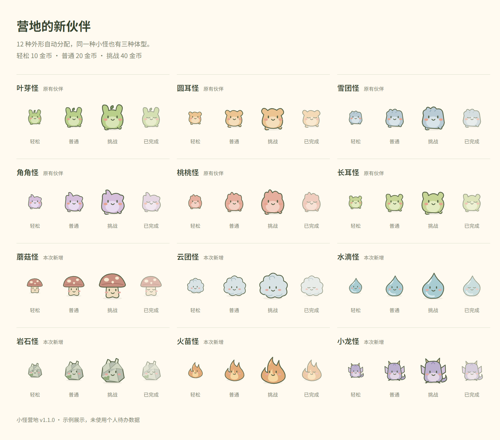

# 小怪营地 · Monster Camp

把每天的工作变成一场轻冒险。适用于 Windows 64 位的离线待办软件：桌面小怪浮标、中文时间识别、任务提醒和营地养成。

当前软件版本：**v1.1.0**。



## 使用软件

版本安装附件命名为 `MonsterCamp-Setup-1.1.0-x64.exe`，通过仓库的 **Releases** 发布；源码目录不包含安装包。发布完成前，本地安装包仍位于 `01_安装包/v1.1.0/`。

已有旧版时，请先备份个人数据并从托盘退出，再安装新版。详细步骤见[使用与更新指南](03_使用与更新说明/使用与更新指南.txt)。

- 12 种小怪自动分配外形，保存后保持不变。
- 轻松／普通／挑战对应三档体型，完成奖励为 10／20／40 金币。
- 中文时间识别、搜索、信箱提醒、删除撤销、营地解锁。
- 离线使用，个人待办保存在自己电脑上。
- 旧数据迁移前自动保存并校验原始副本；回退需配套恢复旧格式数据。

## 项目结构

| 目录 | 内容 |
| --- | --- |
| `02_项目源码` | 当前维护源码、资源、构建脚本和测试 |
| `03_使用与更新说明` | 使用指南、维护交接、版本记录及后续需求 |
| `04_界面预览/v1.1.0` | 示例数据生成的界面截图 |

本地项目中的安装包、历史 ZIP、开发依赖和测试输出不会进入 Git 提交。个人待办数据也不在仓库中。部分文档记录了本地交付目录，其历史备份与安装包路径需要在原始交付文件夹中查看。

## 开发与验证

在 `02_项目源码` 中执行：

```powershell
npm ci
npm test
npm run test:desktop
npm run test:upgrade
npm run dist
```

详细环境和运行方式见[源码说明](02_项目源码/README.md)。普通使用者只需安装 EXE。

v1.1.0 已通过 38 项核心测试，开发程序和最终打包程序各 18 组桌面流程。真实安装向导和覆盖安装尚未实测；安装包未签名。范围和结果见[验收记录](03_使用与更新说明/v1.1.0-验收记录.txt)。

## 后续迭代

子任务、软件内备份恢复、重复任务、分类标签和今日三件重点已列入[后续迭代清单](03_使用与更新说明/后续迭代清单.txt)，当前版本尚未实现。

GitHub 的保存和版本发布流程见[GitHub 使用说明](03_使用与更新说明/GitHub使用说明.md)。

## 许可

代码使用 [MIT License](LICENSE)。Noto Sans SC 字体使用 SIL Open Font License 1.1，字体许可保存在 `02_项目源码/assets/fonts/OFL.txt`。
